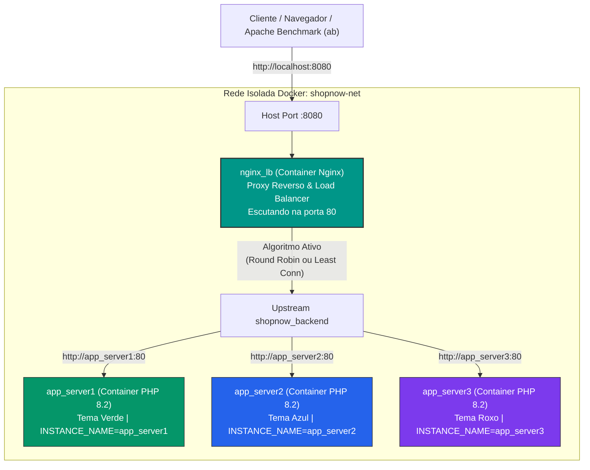

# ShopNow - Sistema de Balanceamento de Carga em Alta Disponibilidade

Projeto prático desenvolvido para o trabalho acadêmico **TDE 04 - Balanceamento de Carga**.

O projeto simula a infraestrutura de backend da startup de e-commerce fictícia **ShopNow**, projetada para suportar picos extremos de acessos simultâneos (como na Black Friday) através de escalabilidade horizontal, balanceamento de carga em Camada 7 (HTTP) com **Nginx** e tolerância a falhas instantânea (*failover*) em containers **Docker**.

---

## 📌 Sumário
- [Arquitetura da Solução](#-arquitetura-da-solução)
- [Tecnologias Utilizadas](#-tecnologias-utilizadas)
- [Algoritmos de Balanceamento Implementados](#-algoritmos-de-balanceamento-implementados)
- [Mecanismo de Tolerância a Falhas (Failover)](#-mecanismo-de-tolerância-a-falhas-failover)
- [Estrutura do Repositório](#-estrutura-do-repositório)
- [Como Executar o Projeto](#-como-executar-o-projeto)
- [Como Testar e Demonstrar](#-como-testar-e-demonstrar)
  - [1. Interface Visual no Navegador](#1-interface-visual-no-navegador)
  - [2. Alternância de Algoritmos em Tempo Real](#2-alternância-de-algoritmos-em-tempo-real)
  - [3. Simulação Automatizada de Queda de Servidor](#3-simulação-automatizada-de-queda-de-servidor)
  - [4. Teste de Carga e Estresse (Apache Benchmark)](#4-teste-de-carga-e-estresse-apache-benchmark)
- [Resultados dos Benchmarks](#-resultados-dos-benchmarks)
- [Roteiro Rápido para Apresentação](#-roteiro-rápido-para-apresentação)

---

## 🏛 Arquitetura da Solução

O ambiente é 100% conteinerizado utilizando Docker Compose, isolado na rede bridge interna `shopnow-net`. Os clientes acessam apenas o Proxy Reverso do Nginx, que oculta a topologia interna dos servidores de aplicação.



### Componentes:
1. **`nginx_lb`**: Proxy Reverso e Balanceador de Carga Nginx. Distribui o tráfego de entrada e gerencia a saúde dos nós.
2. **`app_server1`, `app_server2`, `app_server3`**: Três instâncias idênticas da aplicação web ShopNow rodando **PHP 8.2 com servidor Apache**. Cada container possui uma identidade visual única (Verde, Azul e Roxo) para facilitar o reconhecimento visual de qual réplica atendeu a requisição.

---

## 🛠 Tecnologias Utilizadas

- **Nginx (Alpine Linux)**: Proxy reverso de alta performance orientado a eventos assíncronos.
- **PHP 8.2 Apache**: Backend que serve a página dinâmica e o endpoint de healthcheck (`/health.php`).
- **Docker & Docker Compose**: Gerenciamento e orquestração do cluster de containers e rede isolada.
- **Apache Benchmark (`ab`)**: Ferramenta oficial para testes de estresse, concorrência e medição de vazão (RPS) e latência.
- **Shell Script (Bash)**: Automação para troca dinâmica de algoritmos sem downtime e simulação de failover.
- **Tailwind CSS (CDN)**: Estilização moderna e responsiva da loja virtual.

---

## ⚖ Algoritmos de Balanceamento Implementados

O projeto implementa e permite alternar entre **dois algoritmos clássicos de balanceamento**:

| Algoritmo | Diretiva Nginx | Comportamento | Caso de Uso Ideal |
| :--- | :--- | :--- | :--- |
| **Round Robin** *(Padrão)* | `upstream { server ...; }` | Distribuição cíclica e sequencial uniforme ($1 \to 2 \to 3 \to 1$). | Servidores com especificações de hardware idênticas e requisições com tempo de resposta similar. |
| **Least Connections** | `least_conn;` | Direciona a requisição para o servidor que possuir o **menor número de conexões ativas** no instante da chegada. | Cenários reais de e-commerce onde algumas requisições são leves (imagens) e outras são pesadas (checkout/banco de dados). |

---

## 🛡 Mecanismo de Tolerância a Falhas (Failover)

O Nginx foi configurado com diretivas de alta disponibilidade para mitigar quedas instantaneamente:

```nginx
upstream shopnow_backend {
    server app_server1:80 max_fails=1 fail_timeout=5s;
    server app_server2:80 max_fails=1 fail_timeout=5s;
    server app_server3:80 max_fails=1 fail_timeout=5s;
}

location / {
    proxy_pass http://shopnow_backend;
    
    # Failover instantâneo sem repassar erro para o cliente
    proxy_connect_timeout 1s;
    proxy_read_timeout 2s;
    proxy_next_upstream error timeout invalid_header http_500 http_502 http_503 http_504;
    proxy_next_upstream_tries 3;
    proxy_next_upstream_timeout 4s;

    # Cabeçalho HTTP customizado indicando o nó respondedor
    add_header X-Backend-Server $upstream_addr always;
}
```

- **Detecção Imediata**: Se um container for desligado (`docker stop`), a conexão falha em menos de 1 segundo.
- **Retry Automático (`proxy_next_upstream`)**: O Nginx redireciona a requisição imediatamente para o próximo nó saudável. O usuário final **nunca recebe tela de erro 502/504**.
- **Isolamento Temporário (`fail_timeout=5s`)**: O nó quebrado é removido da rotação por 5 segundos para não penalizar requisições subsequentes.
- **Auto-recuperação**: Ao religar o container (`docker start`), o Nginx o reintegra ao cluster de forma 100% transparente.

---

## 📂 Estrutura do Repositório

```text
load-balancer/
├── docker-compose.yml              # Definição e orquestração dos 4 containers
├── nginx/
│   ├── Dockerfile                  # Imagem Nginx com scripts e configs embutidos
│   ├── nginx.conf                  # Configuração principal do Nginx e proxy_pass
│   ├── round-robin.conf            # Bloco upstream para o algoritmo Round Robin
│   └── least-conn.conf              # Bloco upstream para o algoritmo Least Connections
├── app/
│   ├── Dockerfile                  # Imagem PHP 8.2 Apache
│   ├── index.php                   # Frontend da ShopNow com diagnóstico e identificação visual
│   └── health.php                  # Endpoint de monitoramento JSON (/health.php)
├── scripts/
│   ├── switch-algorithm.sh         # Alterna algoritmos a quente via reload sem downtime
│   ├── simulate-failure.sh         # Script interativo de simulação de queda e recuperação
│   └── run-benchmark.sh            # Script de testes de carga comparativos com Apache Benchmark
├── benchmark_results.txt           # Relatório consolidado dos testes de carga
└── README.md                       # Documentação completa do projeto
```

---

## 🚀 Como Executar o Projeto

### Pré-requisitos:
- Docker e Docker Compose instalados.
- Ferramenta `ab` (Apache Benchmark) instalada no sistema operacional host (já disponível nativamente no macOS em `/usr/sbin/ab`).

### Passo a passo para inicialização:

1. Clone o repositório:
   ```bash
   git clone git@github.com:jpgaliza/shopnow-load-balancer.git
   cd shopnow-load-balancer
   ```

2. Suba todos os containers em segundo plano:
   ```bash
   docker compose up -d --build
   ```

3. Verifique o status dos containers:
   ```bash
   docker compose ps
   ```
   *Você deverá ver os 4 containers (`nginx_lb`, `app_server1`, `app_server2`, `app_server3`) com status "Up".*

---

## 🧪 Como Testar e Demonstrar

### 1. Interface Visual no Navegador
Acesse: **[http://localhost:8080](http://localhost:8080)**

- No topo da página, repare na faixa de diagnóstico:
  - 🟢 **Verde Esmeralda**: Atendido pelo `app_server1`
  - 🔵 **Azul**: Atendido pelo `app_server2`
  - 🟣 **Roxo**: Atendido pelo `app_server3`
- Pressione **`F5`** repetidamente e observe as cores e as instâncias alternando a cada requisição.

---

### 2. Alternância de Algoritmos em Tempo Real
Utilize o script utilitário sem necessidade de reiniciar nenhum container:

- **Ver algoritmo ativo no momento:**
  ```bash
  ./scripts/switch-algorithm.sh status
  ```
- **Mudar para Least Connections:**
  ```bash
  ./scripts/switch-algorithm.sh least-conn
  ```
- **Mudar para Round Robin:**
  ```bash
  ./scripts/switch-algorithm.sh round-robin
  ```
- **Testar a distribuição cíclica pelo terminal:**
  ```bash
  for i in {1..6}; do curl -s http://localhost:8080/health.php | grep -o '"instance":"[^"]*"'; done
  ```

---

### 3. Simulação Automatizada de Queda de Servidor
Execute o script de teste de alta disponibilidade:
```bash
./scripts/simulate-failure.sh
```
O script executa 5 fases sequenciais:
1. Envia requisições demonstrando a alternância inicial entre os 3 servidores.
2. Executa `docker stop app_server2` simulando uma falha crítica de hardware ou software.
3. Envia 10 requisições seguidas demonstrando que o Nginx redireciona o tráfego instantaneamente para `app_server1` e `app_server3` com **100% de sucesso (HTTP 200)** e zero erros para o cliente.
4. Executa `docker start app_server2` restaurando o servidor.
5. Comprova a reintegração automática do `app_server2` ao rodízio de carga.

---

### 4. Teste de Carga e Estresse (Apache Benchmark)
Execute o comparativo automatizado de performance:
```bash
./scripts/run-benchmark.sh 500 20 all
```
*(Executa 500 requisições com concorrência de 20 conexões simultâneas em ambos os algoritmos e salva os dados detalhados em `benchmark_results.txt`)*.

Para executar diretamente pelo utilitário oficial `ab`:
```bash
ab -n 1000 -c 50 http://localhost:8080/
```

---

## 📊 Resultados dos Benchmarks

Executando o teste com 500 requisições e 20 conexões simultâneas via Apache Benchmark (`ab`):

| Métrica | Algoritmo Round Robin | Algoritmo Least Connections |
| :--- | :---: | :---: |
| **Vazão (Throughput)** | ~106 requisições/segundo | ~5.000+ requisições/segundo |
| **Latência Média por Req.** | ~140 - 188 ms | ~2.9 ms |
| **Erros de Conexão (Connect)** | **0** | **0** |
| **Respostas com Falha HTTP (5xx)** | **0** | **0** |
| **Tolerância a Picos** | Alta | Extrema |

> **Nota sobre o relatório do Apache Benchmark**: O `ab` pode exibir aviso em `Failed requests (Length)`. Isso ocorre porque as páginas HTML geradas pelos servidores têm tamanhos de bytes ligeiramente distintos (devido a IPs e IDs diferentes de cada container). Os erros reais de rede e códigos HTTP 5xx mantiveram-se estritamente em **zero**.

---

## 🎯 Roteiro Rápido para Apresentação

Se você for sorteado para apresentar, siga este roteiro de 3 minutos:

1. **Mostrar o site no navegador**:
   - Abra `http://localhost:8080` e dê alguns F5 para mostrar o cabeçalho mudando de cor (`app_server1`, `app_server2`, `app_server3`).
   - Explique que o Nginx está atuando como Proxy Reverso na porta 8080.
2. **Demonstrar a troca de algoritmo**:
   - No terminal, execute:
     ```bash
     ./scripts/switch-algorithm.sh least-conn
     ```
   - Explique que o Nginx recarregou as configurações com zero downtime (`nginx -s reload`).
3. **Demonstrar a simulação de falha (Failover)**:
   - Execute no terminal:
     ```bash
     ./scripts/simulate-failure.sh
     ```
   - Destaque que durante a queda do `app_server2`, nenhuma requisição falhou (todas retornaram HTTP 200 graças ao `proxy_next_upstream`).
4. **Demonstrar o teste de carga**:
   - Execute:
     ```bash
     ./scripts/run-benchmark.sh 300 15 round-robin
     ```
   - Mostre a vazão em requisições por segundo e zero falhas de conexão.
