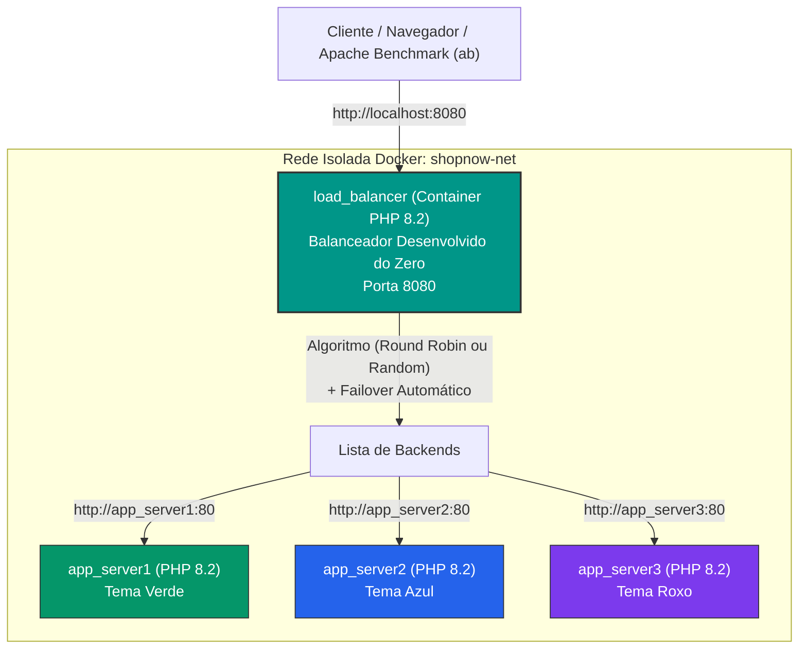

# ShopNow - Balanceador de Carga em PHP Desenvolvido do Zero

Projeto prático desenvolvido para o trabalho acadêmico **TDE 04 - Balanceamento de Carga**.

A infraestrutura foi desenvolvida para simular a startup de e-commerce **ShopNow** sob alta demanda (Black Friday), utilizando um **Balanceador de Carga customizado desenvolvido do zero em PHP**, orquestrado via Docker Compose, com suporte a múltiplos algoritmos de distribuição e tolerância a falhas instantânea (*failover*).

---

## 📌 Sumário
- [Arquitetura da Solução](#-arquitetura-da-solução)
- [Como o Balanceador foi Desenvolvido do Zero](#-como-o-balanceador-foi-desenvolvido-do-zero)
- [Algoritmos Implementados em Código](#-algoritmos-implementados-em-código)
- [Mecanismo de Tolerância a Falhas (Failover)](#-mecanismo-de-tolerância-a-falhas-failover)
- [Como Executar o Projeto](#-como-executar-o-projeto)
- [Como Testar pelo Terminal](#-como-testar-pelo-terminal)
- [Guia Rápido de 1 Minuto para a Apresentação](#-guia-rápido-de-1-minuto-para-a-apresentação)

---

## 🏛 Arquitetura da Solução

O ambiente é 100% conteinerizado utilizando **Docker Compose**, conectado na rede interna `shopnow-net`. Os clientes acessam a porta pública `8080`, onde roda o nosso balanceador de carga em PHP.



---

## 💻 Como o Balanceador foi Desenvolvido do Zero

O balanceador reside no arquivo [`load_balancer/index.php`](load_balancer/index.php). Ele funciona em 4 passos simples:

1. **Lista de Servidores Backend**:
   ```php
   $backends = ['http://app_server1:80', 'http://app_server2:80', 'http://app_server3:80'];
   ```
2. **Seleção de Algoritmo**:
   - **Round Robin**: Utiliza um contador atômico em arquivo para ciclar a lista: `$backends[$counter % 3]`.
   - **Random (Aleatório)**: Sorteia um dos servidores via `array_rand($backends)`.
3. **Encaminhamento HTTP e Failover**:
   - Dispara a requisição para o servidor escolhido via `curl`.
   - Se o servidor responder (HTTP 200..399), repassa o corpo da página e cabeçalhos ao cliente.
   - **Se o servidor falhar** (container caído ou timeout), o código captura o erro e **tenta o próximo servidor imediatamente**.
4. **Cabeçalhos de Diagnóstico**:
   - `X-Load-Balancer: Custom-PHP-Load-Balancer`
   - `X-Algorithm-Used: round_robin | random`
   - `X-Backend-Server: http://app_serverX:80`

---

## 🚀 Como Executar o Projeto

```bash
docker compose up -d --build
```
Acesse no navegador: **`http://localhost:8080`**

---

## 🧪 Como Testar pelo Terminal

### 1. Testar a rotação do Round Robin:
```bash
for i in {1..6}; do curl -sI http://localhost:8080/ | grep "X-Backend-Server"; done
```

### 2. Alternar para o algoritmo Random (Aleatório):
```bash
./scripts/switch-algorithm.sh random
for i in {1..6}; do curl -sI http://localhost:8080/ | grep "X-Backend-Server"; done
```
*(Para voltar ao Round Robin: `./scripts/switch-algorithm.sh round_robin`)*.

### 3. Simular Queda de Servidor (Failover Automático):
```bash
./scripts/simulate-failure.sh
```
*(Derruba o `app_server2`, comprova que 100% das requisições continuam sendo atendidas pelos outros nós sem erros, e restaura o servidor)*.

### 4. Teste de Carga com Apache Benchmark (`ab`):
```bash
ab -n 300 -c 15 http://localhost:8080/
```

---

## 🎯 Guia Rápido de 1 Minuto para a Apresentação

Se você for chamado para apresentar, basta seguir estes 4 pontos:

1. **Onde está o código do balanceador**:
   *"Professor, desenvolvi o balanceador de carga do zero em PHP puro, no arquivo `load_balancer/index.php`."*
2. **Os dois algoritmos**:
   *"Implementei o **Round Robin** (usando divisão modular do índice) e o **Random** (sorteio aleatório). Podemos alternar facilmente via script ou na URL."*
3. **Simulação de falha ao vivo**:
   *"Se derrubarmos uma instância com `docker stop app_server2`, meu código detecta que a conexão falhou e repassa automaticamente a requisição para outro servidor saudável, garantindo 100% de disponibilidade."*
4. **Demonstração rápida**:
   - Rode `./scripts/simulate-failure.sh` no terminal e mostre as 5 fases com resultado de 100% de sucesso.
